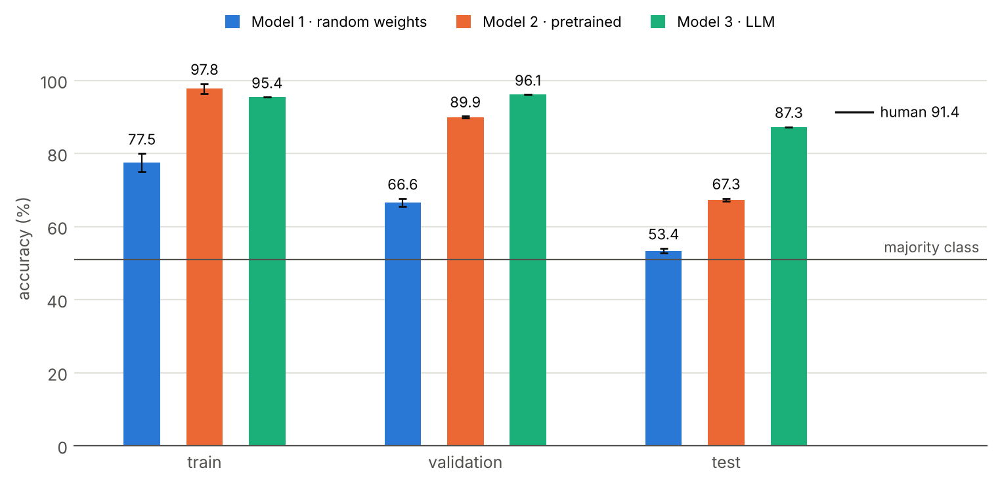
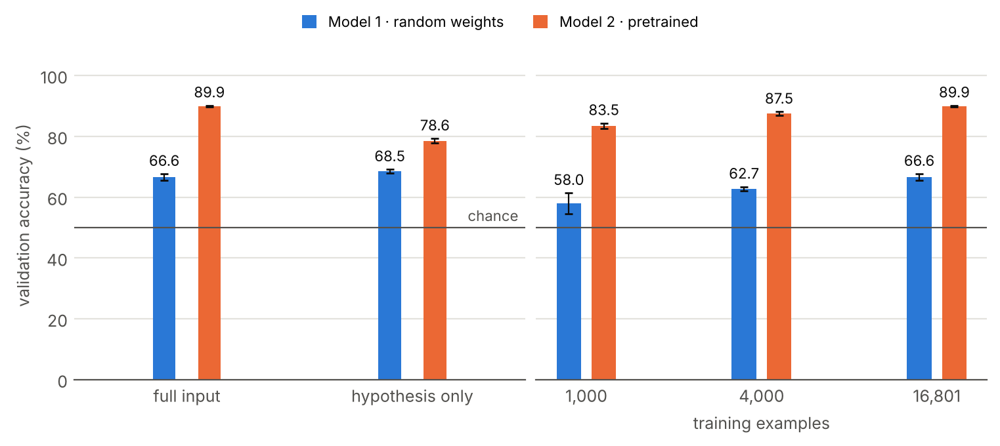

# NLP HS26 - Course Project 2: Transformers on ART (αNLI)

**Author:** Gabriel Gjonaj · HSLU, Natural Language Processing (HS26, A. Marfurt)

**Task:** given two observations *O₁* (before) and *O₂* (after), pick the more plausible of two
hypotheses *h₁*, *h₂* (ART dataset, Bhagavatula et al., 2020; course version `amarfurt/art-nlp-hs26`
with 16,801 / 1,000 / 1,532 examples for train / validation / test).

**Models**
1. `roberta-base` architecture with random weights, finetuned on ART.
2. `roberta-base` with pretrained weights, finetuned on ART. Same model hyperparameters and tokenizer as model 1.
3. Qwen3 235B Instruct, an LLM with 235 billion parameters, used with a prompt only.

## Deliverables

* Code: this repository.
* Weights & Biases: [saved view *Project 2 - final view*](https://wandb.ai/gabriel-gjonaj-hochschule-luzern/nlp-project2-art/workspace?nw=q9an37zffrg)
  (project `nlp-project2-art`). All runs: [*Project 2 - all runs*](https://wandb.ai/gabriel-gjonaj-hochschule-luzern/nlp-project2-art/workspace?nw=cf88ucsn8e4).
* Evaluation: [`notebooks/analysis.ipynb`](notebooks/analysis.ipynb) computes every number and figure of this file from `runs/`.
* [`EXPECTATIONS.md`](EXPECTATIONS.md): the expected accuracies, written on 2026-11-15 before the first experiment.

## Results

Accuracy in %. Models 1 and 2: mean ± standard deviation over 4 seeds. Model 3: one run; its train value
is measured on 1,000 sampled training examples.

| model | train | validation | test |
|---|---|---|---|
| Majority class | 50.4 | 50.8 | 51.0 |
| 1 · `roberta-base`, random weights | 77.5 ± 2.5 | 66.6 ± 1.0 | 53.4 ± 0.6 |
| 2 · `roberta-base`, pretrained | 97.8 ± 1.3 | 89.9 ± 0.3 | 67.3 ± 0.4 |
| 3 · Qwen3 235B Instruct, 8 examples in the prompt | 95.4 | 96.1 | 87.3 |
| Human performance (Bhagavatula et al., 2020) | - | - | 91.4 |



* **Pretraining matters more than training on the task.** With the same architecture and the same data,
  pretraining adds 14 points on test. The LLM, which is not trained on ART at all, adds another 20 and
  stays 4 points below human performance.
* **Model 1 learns cues in the hypotheses, not the task.** Without the observations it reaches 68.5 ± 0.7 %
  on validation, with them 66.6 ± 1.0 %. It is right in 94 % of the validation pairs where only the wrong
  hypothesis contains a negation word, and in 22 % where only the correct one does.
* **Model 2 uses the observations and needs little data.** Without the observations it falls from 89.9 to
  78.6 %. With 1,000 training examples it reaches 83.5 %, more than model 1 with all 16,801.
* **The test split is harder for every model.** The test pairs were filtered with BERT as the adversary.
  From validation to test, model 1 loses 13 points, model 2 loses 23 and the LLM loses 9.



The notebook contains the confusion matrices, the training curves, the learning rate search, all ablations,
the choice of the LLM and of the prompt, and the error analysis. Compared with `EXPECTATIONS.md`: model 1
is inside the expected ranges; model 2 is 1.9 points above the range on validation and 0.7 below it on test;
the LLM is 2.1 points above the range on validation and inside it on test.

## Approach

* **Input (models 1 and 2):** one sequence per hypothesis, `<s> O₁ h </s></s> O₂ </s>`, built with the
  tokenizer of `roberta-base` for both models. No lowercasing, stemming or stopword removal: the tokenizer
  is cased and works on subwords. The longest sequence has 65 tokens, so the limit of 128 tokens never
  truncates. A batch is padded to its longest sequence, and the attention mask hides the padding.
* **Model:** encoder without pooling layer, hidden state of `<s>`, classifier (dropout, linear, tanh,
  dropout, linear) that gives one score per hypothesis, softmax over the two scores. 124.6 M parameters.
* **Training:** cross-entropy, AdamW (weight decay 0.01), 10 % linear warmup and linear decay, gradient
  clipping at 1.0, batch size 32, mixed precision. The checkpoint with the best validation accuracy is
  kept, with early stopping on the validation accuracy. Final learning rates: 2e-5 for model 1 (up to 30
  epochs) and 1e-5 for model 2 (5 epochs).
* **Model 3:** chat prompt with the task, 8 solved training examples (4 per label) and the question; the
  model answers `1` or `2`. Temperature 0, called through Hugging Face Inference Providers (DeepInfra).
  An answer without a readable 1 or 2 counts as wrong.
* **Selection:** every decision uses the validation split. The test split is evaluated but never used for
  a decision; the LLM is run on it once, with the selected prompt.

## Experiments

Each group of runs answers one question: 50 training runs (9.6 GPU hours on one NVIDIA A16) and 12 LLM
runs (3.7 M input and 0.5 M output tokens, less than 1 USD).

| question | what varies | runs |
|---|---|---|
| Which learning rate? | 4 values per model, seed 42 | 8 |
| How large is the seed noise? | seeds 1, 2, 3 for the final configurations and for model 2 with 3e-5 | 9 |
| What do the models use? | hypothesis only and segment order (4 seeds), pooling | 15 |
| How much data is needed? | 1,000 and 4,000 training examples (4 seeds) | 16 |
| Settings of model 2 | classifier learning rate, 10 instead of 5 epochs | 2 |
| Which LLM and which prompt? | 5 models on 200 validation examples; zero-shot, few-shot (4 and 8 examples), step by step, swapped hypotheses and a reasoning model on the whole validation split; one final run | 12 |

The plan of every phase is the header of its script in `scripts/`.

## Reproduce

```bash
git clone https://github.com/tagjonaj/nlp-project2-art.git && cd nlp-project2-art
pip install -r requirements.txt
python -m pytest -q tests                  # 45 checks, runs on a CPU

python scripts/data_overview.py            # splits, labels, lengths
python scripts/show_batch.py               # input format and the tensors of one batch
python scripts/show_model.py               # configuration and parameter counts of models 1 and 2

# models 1 and 2 (GPU; the run scripts log to the W&B entity in WANDB_ENTITY, default: mine)
python train.py --pretrained false --lr 2e-5 --max_epochs 30 --patience 5   # model 1, final configuration
python train.py --pretrained true --lr 1e-5                                 # model 2, final configuration
bash scripts/run_phase1.sh                 # learning rate search
bash scripts/run_phase2.sh                 # seeds and ablations
bash scripts/run_phase3.sh                 # seeds for the ablations that carry a claim

# model 3 (needs a Hugging Face token: python -c "from huggingface_hub import login; login()")
bash scripts/run_llm_pilot.sh              # 5 models, 200 validation examples
bash scripts/run_llm_prompts.sh            # prompt formats on the whole validation split
bash scripts/run_llm_final.sh              # selected prompt on a train sample, validation and test

python scripts/collect_results.py          # runs/ -> results/summary.csv and results/summary_llm.csv
jupyter nbconvert --to notebook --execute --inplace notebooks/analysis.ipynb   # tables and results/figures/
```

Every run writes `runs/<name>/` with its configuration, results, predictions and curves. All run folders
are in the repository, so the notebook runs without training and without access to the LLM.

## Repository

```
artp2/           data.py (loading, input format, batching) · models.py · lit.py (training step, optimizer, schedule)
                 train.py (runner for models 1 and 2) · llm.py (model 3) · analysis.py (evaluation)
train.py llm.py  command line entry points
scripts/         run_*.sh (one experiment plan per phase) · collect_results.py · data_overview.py · show_batch.py · show_model.py
tests/           checks for the pipeline, the LLM code and the evaluation
runs/            one folder per run: config.json, results.json, predictions_*.csv, curves; LLM runs also the answers
results/         summary.csv · summary_llm.csv · figures/
notebooks/       analysis.ipynb
```

## Tools and sources (declaration)

* Libraries: PyTorch, Lightning, Weights & Biases, Hugging Face `transformers`, `datasets` and
  `huggingface_hub`, matplotlib, pandas.
* **Claude (Anthropic) is used as a coding assistant** for writing and reviewing code, tests and
  documentation, and as a discussion partner for design decisions.
* Course material (lecture slides and notebooks of NLP HS26) as reference.
* Models: `roberta-base` (Liu et al., 2019) and `Qwen/Qwen3-235B-A22B-Instruct-2507` (model card on the
  Hugging Face Hub). The LLM pilot also used Llama 3.3 70B, gpt-oss 120B, GLM 5.2 and DeepSeek V4 Pro.

**References**

* Bhagavatula et al. (2020): Abductive Commonsense Reasoning. ICLR. arXiv:1908.05739.
* Liu et al. (2019): RoBERTa: A Robustly Optimized BERT Pretraining Approach. arXiv:1907.11692.
* Vaswani et al. (2017): Attention Is All You Need. NeurIPS.
* Zero-shot LLM reference on αNLI used in `EXPECTATIONS.md`: arXiv:2507.08264.
